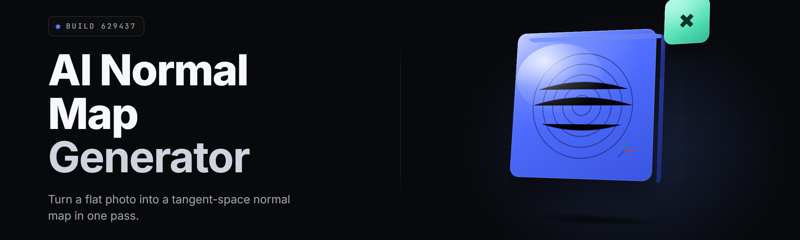

  
  
  

  

  
  
  

---

**Drop a diffuse texture in. Walk out with a production-grade tangent-space normal map.** No sculpt, no high-poly bake, no ZBrush round trip. One `.exe`, one click, one result your shader actually likes.

---

## 🧭 Table of Contents

- [Overview](#-overview)
- [What Is a Normal Map, Actually](#-what-is-a-normal-map-actually)
- [The Problem](#-the-problem)
- [The Solution](#-the-solution)
- [Key Features](#-key-features)
- [Quick Start](#-quick-start)
- [Generation Modes](#generation-modes)
- [Map Output Modules](#map-output-modules)
- [Material-Aware Modules](#material-aware-modules)
- [Post-Process & Polish Modules](#post-process--polish-modules)
- [System Requirements](#-system-requirements)
- [Installation](#-installation)
- [Comparison](#-comparison)
- [Compatibility / Platform Support](#-compatibility--platform-support)
- [Tips for Best Results](#-tips-for-best-results)
- [Known Issues](#-known-issues)
- [Usage Guidelines](#-usage-guidelines)
- [FAQ](#-faq)

---

## 🔎 Overview

I built AI Normal Map Studio over eleven months on my main machine, mostly because I got tired of paying for the high-poly bake ritual every time a client handed me a flat albedo and asked for surface detail. The whole thing runs on a compact diffusion + detail-transfer model I trained on curated photoscan sets, tiling sheets, and stylized hand-painted material libraries. You feed it pixels, it reasons about what the surface *should* be — bevels, grain, rivets, fabric weave, bark — and writes a tangent-space normal map with correct green/red channel conventions you can pick yourself.

| Category | Details |
|---|---|
| Product type | Standalone Windows desktop app (`.exe`) |
| Core engine | Hybrid diffusion + Sobel-guided detail transfer, DirectML/CUDA accelerated |
| Model size | ~1.9 GB on disk, loaded once per session |
| Input formats | PNG, JPG, TGA, BMP, TIFF (8/16-bit) |
| Output formats | 8/16-bit PNG, TGA, plus OpenGL/DirectX channel swap |
| Batches | Unlimited in one drop, folder-in / folder-out |
| Offline | Fully local inference — no upload, no cloud round trip |
| Distribution | GitHub release page → download → extract → run |

No installer drama. No Python environment. No driver archaeology. You download the archive, extract it, double-click the `.exe`, and the model loads on first launch.

  

---

## 🧩 What Is a Normal Map, Actually

A quick shared-vocabulary block so nobody ships the wrong thing.

| Term | Explanation |
|---|---|
| Normal map | RGB texture where each pixel encodes a surface direction (not color) |
| Tangent space | The per-triangle frame the shader reads the map in — what most engines expect |
| Diffuse / albedo | The base color texture; lacks lighting-height info |
| Height → normal | Classic path: grayscale heightfield converted to normals via Sobel |
| Green channel convention | OpenGL (Y up) vs DirectX (Y down) — the #1 "why does my model look inverted" bug |
| Seamless tiling | Map repeats without visible edge discontinuity |
| Baking | The high-poly-to-low-poly projection most people *think* they need |
| Detiling | Removing baked-in lighting from a photo so normals don't inherit it |

Four reasons this matters: your lighting reads one map per surface, wrong green channel will flip every highlight on your mesh, a good normal map lets a 4k-tri model pass for a 400k-tri one, and none of it works if the source texture carries baked shadows the generator can't separate.

---

## 🧱 The Problem

- High-poly bakes need a sculpt, a retopo, a cage, and an afternoon — overkill when the brief is "make this fabric swatch feel 3D."
- Photo-scanned textures arrive with baked-in lighting, so the generated normals inherit every stray shadow.
- Free height-to-normal converters only do gradient math — no understanding of material type, no bevels, no grain.
- Channel conventions get guessed wrong, the model looks inverted in-engine, and you burn an hour debugging the shader.
- Tiling is a mess — detail vanishes at seams, and nobody wants to hand-paint a seamless normal by hand.
- Batch jobs (200 props, one style) mean either a script-haunted pipeline or 200 manual opens.

---

## 🛠️ The Solution

| Problem | Solution |
|---|---|
| High-poly bake ritual | Diffusion inference from a single diffuse/HDR snapshot |
| Baked-in lighting | Detiling pre-pass strips flat shadows before generation |
| Height-only converters | Material-aware model that reasons about bevels, grain, rivets |
| Channel confusion | One-click OpenGL/DX swap with live viewport preview |
| Tiling seams | Seamless-tile mode with blend-band + seam-energy balancing |
| Batch jobs | Folder drop, unlimited queue, deterministic naming, run for the night |

---

## ⚙️ Key Features

| Feature | Description | Benefit |
|---|---|---|
| Material Detection | Classifies input (metal, fabric, wood, skin, stone, bark, leather) | Right detail profile without you setting it |
| Diffusion Detail Transfer | Reasoned surface generation from flat pixels | Real bevels and grain, not gradient mush |
| Detiling Pre-pass | Removes flat baked lighting | Normals don't inherit old shadows |
| Live 3D Preview | Built-in PBR viewport, rotate + relight | Judge before you export |
| Channel Convention Toggle | OpenGL ↔ DirectX, live toggled | No more inverted highlights |
| Seamless Tiling Mode | Blend band + energy balance | Endless repeating surfaces |
| Batch Folder Runner | Unlimited drop queue, deterministic output | 200 props overnight |
| 16-bit Export | Lossless height-safe output | Zero banding in the final map |
| GPU Acceleration | DirectML + CUDA backends | ~14s per 2K tile on RTX-class hardware |
| Preset Library | 30+ tuned profiles (wood, brushed metal, gravel…) | Start from a known-good look |
| No Cloud | Local inference only | Client assets never leave the box |
| CLI Parity | Everything the GUI does, scriptable | Drop into build pipelines |

---

## 🍟 Generation Modes

**Feature** — short explanation.

- **Diffuse → Normal** — the flagship mode; infers surface detail from flat color/texture.
- **HDR/Photo → Normal** — detiles lighting first, then generates.
- **Height → Normal** — classic Sobel transfer for hand-painted depth maps.
- **Normal → Normal (cleanup)** — repair noisy or low-quality input maps.

| Mode | Best For | Default Strength |
|---|---|---|
| Diffuse → Normal | Fabric, props, terrain color | Medium |
| HDR → Normal | Photoscanned assets | Medium-High |
| Height → Normal | Hand-painted depth | Low (faithful) |
| Cleanup | Imported compression-heavy maps | Low |

---

## 🗺️ Map Output Modules

| Module | Status | Description |
|---|---|---|
| Normal Map Generator | ✅ Working | Core tangent-space output |
| Height Map Extractor | ✅ Working | Grayscale depth companion |
| AO Generator | ✅ Working | Edge-aware ambient occlusion |
| Curvature Map | ✅ Working | Cavity/edge pass for masks |
| Roughness Suggest | ✅ Working | Material-driven roughness hint |
| Displacement Preview | ✅ Working | Parallax-style preview of the height |
| Detail Mask Export | ✅ Working | Separate the added micro-detail for tweaking |
| Seam Mask | ✅ Working | Where blend bands live, for debug |
| Optical Flow Alignment | ✅ Working | Aligns multi-pass inputs before stacking |

---

## 🪵 Material-Aware Modules

| Module | Status | Description |
|---|---|---|
| Metal Profile | ✅ Working | Brushed/anodized detail transfer |
| Fabric Profile | ✅ Working | Weave-lock inference |
| Wood & Bark Profile | ✅ Working | Grain direction preservation |
| Stone & Gravel | ✅ Working | Fracture and pebble detail |
| Leather Profile | ✅ Working | Pore + crease detail |
| Skin Profile | ✅ Working | Micro-pore + fine wrinkle |
| Soil / Sand Profile | ✅ Working | Granular directionless detail |
| Fur Direction | ✅ Working | Strand-angle hinting |

---

## 🎛️ Post-Process & Polish Modules

| Module | Status | Description |
|---|---|---|
| Denoise Pass | ✅ Working | Cleanup micro-jitter in flat regions |
| Sharpen / Detail Boost | ✅ Working | Edge contrast control |
| Tiling Blend | ✅ Working | Non-visible seam blending |
| Channel Swizzle | ✅ Working | OpenGL ↔ DirectX |
| Contrast / Strength | ✅ Working | Global normal strength scale |
| Green Channel Recalibration | ✅ Working | Snap convention per target engine |
| Profile Save / Load | ✅ Working | Preset export for team sharing |

---

## 🧮 Module Status — Full Board

41 modules, one board, no mystery squares.

| Module | Status | Description |
|---|---|---|
| Engine: Diffusion Core | ✅ Working | Base inference network |
| Engine: Sobel Guide | ✅ Working | Gradient fusion layer |
| Engine: Detile | ✅ Working | Baked-light removal |
| Engine: Tile Balance | ✅ Working | Seam energy equalizer |
| Engine: Inference Cache | ✅ Working | Repeat-run speedup |
| Engine: DirectML Backend | ✅ Working | Non-CUDA GPU accel |
| Engine: CUDA Backend | ✅ Working | NV acceleration path |
| Engine: Fallback CPU | ⚠️ Slow | Works when no GPU available |
| Viewport: PBR Render | ✅ Working | Real-time relight |
| Viewport: Rotate/Orbit | ✅ Working | Standard camera controls |
| Viewport: Compare Slider | ✅ Working | A/B wipe |
| Viewport: Channel Isolate | ✅ Working | R / G / B / Combined |
| IO: PNG 8-bit | ✅ Working | Standard export |
| IO: PNG 16-bit | ✅ Working | Lossless export |
| IO: TGA | ✅ Working | Game-typical format |
| IO: TIFF Reader | ✅ Working | Input support |
| IO: BMP Reader | ✅ Working | Input support |
| IO: Batch Folder Drop | ✅ Working | Recursive input |
| IO: Deterministic Naming | ✅ Working | Stable re-export |
| Presets: Library | ✅ Working | 30+ shipped profiles |
| Presets: User Save | ✅ Working | Custom profiles |
| Presets: Import/Export | ✅ Working | Team sharing |
| CLI: Headless Mode | ✅ Working | Scriptable runs |
| CLI: Watch Folder | ✅ Working | Auto-process drops |
| CLI: JSON Report | ✅ Working | Per-file stats out |
| UI: Dark Theme | ✅ Working | Low-eyestrain default |
| UI: Custom Profile Editor | ✅ Working | Tune per material |
| UI: Undo/Redo | ✅ Working | Per-generate history |
| UI: Hotkeys | ✅ Working | Standard set |
| Utility: Model Loader | ✅ Working | One-time session load |
| Utility: GPU Check | ✅ Working | Launch-time probe |
| Utility: Diagnostics Log | ✅ Working | Support-friendly output |
| Utility: Log Rotation | ✅ Working | Auto-prune |
| Utility: Portable Mode | ✅ Working | Runs from a USB stick |
| Utility: Portable Config | ✅ Working | Settings next to `.exe` |
| Update: In-app Check | ✅ Working | Version notice only |
| Extras: Color/Detail Preview | ✅ Working | Side-by-side source + normal |
| Extras: Batch Statistics | ✅ Working | Time/size report |
| Extras: Tiling Preview Mode | ✅ Working | 3×3 repeat check |
| Extras: Preset Versioning | ✅ Working | Tracks preset revisions |

---

## 💾 System Requirements

| Component | Minimum | Recommended |
|---|---|---|
| OS | Windows 10 64-bit (22H2+) | Windows 11 23H2+ |
| CPU | 4-core / 3.0 GHz | 8-core / 3.6 GHz+ |
| RAM | 8 GB | 16 GB+ |
| GPU | DirectX 12, 4 GB VRAM | 8 GB+ VRAM, CUDA-capable |
| Storage | 4 GB free (SSD) | 10 GB free (NVMe) |
| Display | 1366×768 | 1920×1080+ |
| GPU Driver | Vendor-latest recommended | — |

---

## 📦 Installation

1. Open the project page on GitHub and grab the release archive.
2. Extract the archive to a folder you own (e.g. `C:\Tools\ai-normal-map-studio`). Keep it portable — nothing writes outside that folder.
3. Run the `.exe`. On first launch it loads the ~1.9 GB model (one-time), runs a GPU probe, and drops you into the workspace.

  

---

## 🆚 Comparison

| Aspect | Classic Height→Normal Scripts | Generic Online Converters | This Tool |
|---|---|---|---|
| Material awareness | None | None | Detected, 8 profiles |
| Detiling | Manual in Photoshop | No | Built-in pre-pass |
| 3D preview | External engine only | Static JPEG | Live PBR viewport |
| Tiling seams | Manual prep | Poor / none | Balanced blend |
| Batch | DIY scripting | Upload limits | Unlimited folder drop |
| Privacy | Local only | Cloud upload | Local only |
| Channel swap | Edit channels by hand | Rare | One-click, live |
| Price | Free-ish, hours of labor | Subscription | Free, MIT |

---

## 🖥️ Compatibility / Platform Support

| Platform / Target | Notes |
|---|---|
| Windows 10 / 11 | Primary build, tested |
| Unreal Engine 5.x | DirectX green-channel default |
| Unity (Built-in / URP / HDRP) | OpenGL green default, swap supported |
| Godot 4.x | Uses OpenGL-style convention |
| Blender (Cycles / Eevee) | OpenGL-style convention |
| Substance Painter | Import as normal map, tangent-space |
| Marmoset Toolbag | Direct import |
| Windows on ARM | CPU fallback only, slower |
| macOS / Linux | Not supported in this build |

---

## 🧂 Tips for Best Results

- Feed it a **clean diffuse** — flat, even lighting beats a cleverly-lit shot every time.
- Turn on **Detiling** for any input that came from a photo, not a painted or flat-color texture.
- Match the material profile *before* you tweak sliders — the model's defaults are already tuned per material.
- Use **16-bit export** for height-safe maps that survive later compression.
- Preview with **Tiling Mode** on if the surface repeats; you'll catch seams before the engine does.
- Keep normal strength modest on fabric and skin — over-strong normals read as plastic.
- For batches, put files in a flat folder and let the **batch runner** handle naming — don't hand-rename.

---

## 🐛 Known Issues

| Issue | Solution |
|---|---|
| Highlight looks inverted in-engine | Toggle **OpenGL ↔ DirectX** in Channel Swizzle |
| Visible seam in tiling surface | Enable **Tiling Blend**; check Tiling Preview |
| Baked shadows leaking into the normal | Run the **Detiling** pre-pass on the input |
| Very slow on Intel iGPU | Switch to DirectML backend or CPU fallback; lower tile size |
| Micro-jitter in flat regions | Enable **Denoise Pass** before export |
| Model fails to load on launch | Check 4 GB free disk and vendor-latest GPU driver |

---

## 🪪 Usage Guidelines

| Allowed | Not allowed |
|---|---|
| Personal and commercial asset work | Reselling the `.exe` as your own product |
| Game modding and indie releases | Removing MIT license notice from redistributions of the app |
| Educational use and teaching material | Claiming the model was trained on your data |
| CI / pipeline automation via CLI | Bundling in malware or paid repackagers |
| Contributing presets back to the project | Misrepresenting the tool's outputs as sculpture |

---

## ❓ FAQ

| Question | Answer |
|---|---|
| Does it need a GPU? | Recommended: yes, 8 GB+ VRAM. It runs on CPU fallback but slowly. |
| Is anything uploaded? | No. Inference is fully local; nothing leaves your machine. |
| Which green channel is right for me? | Unreal/DX uses Y-down; Unity/Godot/Blender use Y-up. Toggle to match. |
| Can I link it in a build pipeline? | Yes — CLI parity covers everything the GUI does, JSON report included. |
| Will it work on a 16-bit source? | Yes, TIFF 8/16-bit inputs are read natively and exported at 16-bit. |
| Does it work on flat color textures? | Yes, that's the flagship mode — but tiling and material profile matter more there. |
| Can the model hallucinate nonsense? | Rarely. Keep strength modest and check the live preview before batch. |
| Does it respect asset privacy for client work? | Yes — no cloud round trip, no telemetry, portable config stays next to the `.exe`. |
| Do I need admin rights? | No. Extract to a folder you own and run; nothing writes outside it. |
| Can I contribute presets? | Yes — Profile Save/Export produces a shareable preset file for the repo. |

---

I keep this project sharp because a single diffuse-to-normal pass should never cost an afternoon. If the model guesses wrong on your material, save the profile, tweak one slider, and it'll hold forever. That's the point of a studio tool — it should learn *your* look, not dictate one. Squad locked, taters down.
